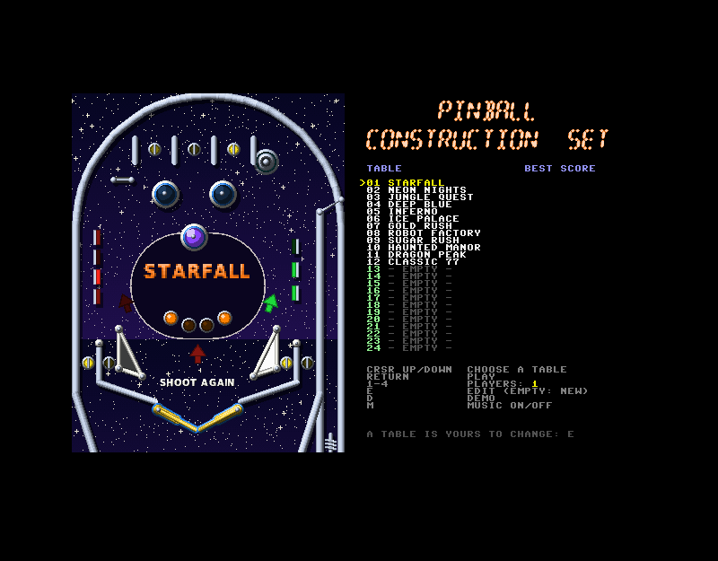
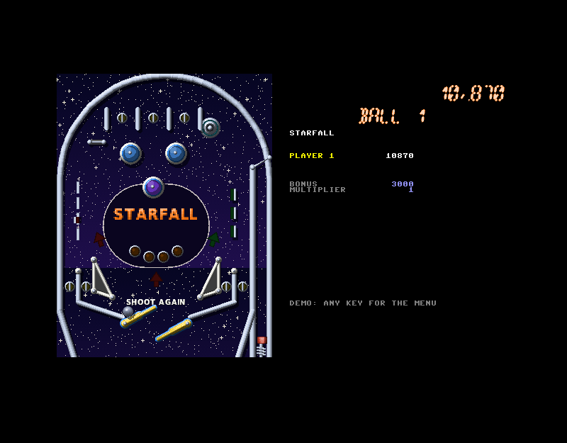
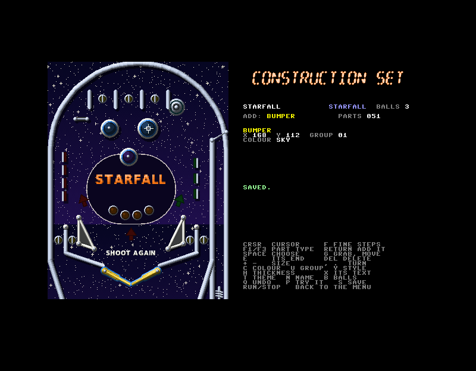

# Pinball Construction Set

A pinball construction set for the MEGA65: build tables from parts, play
them, save them. Twelve tables come with it. It is written in C (and some
45GS02 assembly) with the [M65Compiler](../m65compiler) tool suite (cc45,
ca45, ln45, disk45, tune45).





## Build and run

```sh
make            # build/pinball.d81: the programs, their overlays, art, sounds, 12 tables
make run        # boot it in xemu-xmega65
make screenshot # run it headless -> build/screenshot.png (SHOT_DELAY=<s>)
make previews   # every table drawn on the PC by the same renderer -> build/previews/sheet.png
make sim        # a robot plays every table on the PC: ball times, stuck balls
make clean
```

Variables: `M65=<path>` (the compiler tree, default `../m65compiler`),
`XEMU=<emulator>`, `DEFS=-DAUTODEMO` (straight into the robot's demo) or
`DEFS=-DAUTOEDIT` (straight into the editor), `DEFS="-DAUTODEMO -DFLIPTEST"`
(the demo with the left flipper held up), for tests without a keyboard.
After changing `DEFS`, touch `src/*.c`. Needs Python 3 with numpy and Pillow.

On a MEGA65: copy `build/pinball.d81` to the SD card, mount it and
`RUN "PINBALL"`. It needs attic RAM (every production MEGA65 and xemu have
it).

## Playing

| Key | Joystick | |
|---|---|---|
| left SHIFT, Z, CTRL | left | left flippers |
| right SHIFT, / | right | right flippers |
| RETURN, cursor down (hold, let go) | fire, down | the plunger: the longer, the harder |
| SPACE | up | nudge (too often: DANGER, then TILT) |
| P | | pause |
| RUN/STOP | | back to the menu |

In the menu: cursor up/down chooses a table (it is drawn when the choice
rests), RETURN plays it, 1-4 sets the number of players, E edits it (an
empty slot: a new table), D runs the demo, M turns the music off. Left alone
for a while the menu runs the demo by itself.

### The rules

Every table plays by the same rules, made from its parts:

- **Banks.** Targets, drop targets and rollovers in the same group (1-12)
  are a bank. Each one hit lights (a drop target falls); the whole bank
  lit scores 10,000 x completions, raises the bonus multiplier (up to 5x),
  lights the lock (if the table has one) or, every second time, the extra
  ball. Drop targets come back up a moment later.
- **Lane change.** A bank made only of rollovers moves its lit lanes with
  the flippers. One of its lanes blinks at the start of a ball: the skill
  shot (25,000) for a well judged plunge.
- **Kickers.** A kicker in group 14 gives the extra ball when it is lit. A
  kicker marked *lock* holds the ball while the lock is lit; two balls
  locked start a three-ball multiball, and during multiball the lock
  kicker is the jackpot (50,000, then 25,000 more each time). Other
  kickers score 5,000.
- **Bumpers** 100 (more after their group's completions), slingshots and
  rubbers 10, spinners 100 a half turn, rollovers and targets 500,
  drop targets 1,000. Each target or lane adds 1,000 to the bonus, counted
  (times the multiplier) at the end of the ball.
- **Ball save** for the first 12 seconds of each ball; **tilt** after two
  warnings.
- **Lamps** show the groups: a bank's arrows blink while it waits and light
  one by one with its completions; group 15 lamps are the multiplier's
  ladder, group 14 the extra ball (solid: shoot again), group 13 the lock.

The best score on each table is kept on the disk with three initials.

## The construction set

E in the menu opens the chosen table (or a new one, from an empty frame
with flippers, slingshots, lanes and the plunger already in place). The
table is shown as it plays; every change is drawn again at once.

| Key | |
|---|---|
| cursor keys | move the cross (F: fine steps of a pixel) |
| F1 / F3 | the kind of part to add |
| RETURN | add one at the cross (a wall or a gate: RETURN at each end) |
| SPACE | choose the part nearest the cross (again: the next one) |
| G | grab the chosen part: it follows the cross (G again to let go) |
| E | move its other end (a wall, a gate) or its radius (an arc) |
| DEL | delete it |
| + / - | size: a bumper's or post's radius, a flipper's length, a sling's height, a spinner's width, an arc's radius, text size, a decal's size, a lamp's shape |
| , / . | turn: a target's or kicker's or spinner's or lamp's angle; flip a flipper or a slingshot to the other side |
| F5 / F7 | an arc's length |
| C | colour (16) |
| U | group (0-15) |
| Y | style: rail, rubber, plastic or wood (walls, arcs, posts); a decal's shape and shade |
| H | thickness of a wall or arc |
| X | edit a text part's words |
| T | the table's theme (12: colours and the playfield's pattern) |
| N | the table's name |
| B | 3 or 5 balls |
| Q | undo the last change |
| P | try the table (a game; RUN/STOP comes back to the editor) |
| S | save it, to any of the 24 slots |
| RUN/STOP | back to the menu (it asks if the table is not saved) |

### The parts

| Part | |
|---|---|
| wall | a straight rail, rubber band, plastic guide or wooden wall |
| arc | a curved wall (the top arch, orbits) |
| bumper | a pop bumper: kicks the ball away, lights up |
| post | a rubber or metal post |
| slingshot | the triangle above a flipper, its long side kicks |
| flipper | left or right, any length; upper flippers too |
| target | a standup target |
| drop target | falls when hit; its bank comes back up |
| rollover | a lane switch with a lamp |
| kicker | a saucer: holds the ball, then kicks it out at its angle |
| spinner | spins on a ball passing under it |
| lamp | an insert: round, arrow, triangle or oval |
| text | words printed on the playfield |
| gate | the ball passes it one way only |
| plunger | where the ball starts (one a table) |
| decal | a printed area of the playfield |

## The twelve tables

| | | |
|---|---|---|
| 1 Starfall | space | three bumpers, lanes, drop targets, a spinner, an extra-ball kicker |
| 2 Neon Nights | neon grid | four bumpers, orbits with spinners, a five-target bank, lock and multiball |
| 3 Jungle Quest | jungle | an upper flipper, two banks, an extra-ball kicker |
| 4 Deep Blue | ocean | bubble bumpers, a diagonal drop bank, lock and multiball |
| 5 Inferno | fire | five bumpers, an upper flipper, target and drop banks |
| 6 Ice Palace | ice | four lanes, two drop banks, lock and multiball |
| 7 Gold Rush | wood | three spinners, two drop banks |
| 8 Robot Factory | tread plate | two four-target drop banks, lock and multiball |
| 9 Sugar Rush | sweets | a field of posts under three bumpers |
| 10 Haunted Manor | bricks | lock and multiball, spinner, banks |
| 11 Dragon Peak | rays | two upper flippers, lock and multiball |
| 12 Classic 77 | an electro-mechanical table | four lanes, three bumpers, two kickers, five balls |

Their parts are in `tools/tables.py`; `make previews` draws them on the PC.

## How it works

**Two programs.** `PINBALL` is the menu, the editor and the renderer;
`PLAY` is the game. Each loads the other over itself (a stub at `$1F10`
loads it through the KERNAL and starts it). They hand over through memory
neither one's code uses: the table at `$C600`, a mailbox at `$CD00`, the
index of tables at `$1C80`, the collision grid's items at `$1500`, and attic
RAM (the drawn table, its flippers' images, the physics' colliders).

**Mapped code overlays.** The C code is far bigger than the 40 KB of bank
0, so nearly all of it is in code overlays of 8 KB at most, mapped (MAP)
into a window at `$6000`-`$7FFF`: switching costs a few instructions, so
the physics, the rules and the drawing call across overlays freely. The
overlays are kept in the C65 ROM's area (`$30000`-`$3BFFF`, `$24000`-
`$27FFF`: BASIC, its graphics and the monitor are not used). Each program's
first piece of code write-enables it (a hypervisor call, which toggles the
protection: only when a test write fails). The RAM at `$C000`-`$CFFF` is the
programs' (`disk.s45`, from `race`, maps the ROM back in only for KERNAL
calls); big arrays are in a section at `$8000`, above the window.

**The display.** VIC-IV at 640 x 400 with 16-bit characters. The table
(304 x 400) is 38 columns of full-colour characters numbered down the
columns, so a strip of 8 x 400 pixels is 3,200 contiguous bytes that one
DMA job moves. The panel is ROM text and full-colour 16-segment glyphs
(`tools/gen_assets.py`; the 336 characters of the 49 glyphs are 98
different ones, kept once). The ball, its shadow and the plunger's knob are
16-colour sprites. Dropped targets are put back from a second copy of the
table drawn with them down.

**The flippers** are on the raster rewrite buffer, not in the table's
characters. A screen row is 99 cells: the 80 shown, then for up to two
flippers a GOTOX cell (back to the flipper's x, any pixel, with its pixels
of value 0 transparent) and up to eight of the flipper's characters, then a
GOTOX to the right edge (the VIC-IV shows only what is left of the last
character drawn). Each flipper's characters are a buffer in chip RAM;
twelve images of each position are rendered once into attic RAM, and moving
a flipper is one DMA job of its new image into its buffer. Nothing under a
flipper is ever redrawn. A row has room for two flippers: a third whose
rows are all taken is not shown.

**The renderer** draws the table from its parts on the MEGA65 itself, a
strip at a time (every primitive clips itself to the strip), so the editor
shows exactly what will be played. Nearly everything is a "blob": the
pixels within r of a segment or point, shaded as a tube or a dome by the
light from the top left (`src/blob.s45`: the inner loop in assembly);
plastics are polygons with a bevel; raised parts cast shadows (the
playfield's palette has shadow twins). The playfield has a gradient and one
of 12 patterns. Lamps are palette slots (three entries each): lighting one,
or a bumper's flash, or a lamp fading like a bulb, changes the palette and
never the picture. The same C builds on the PC (`host/preview.c`), and the
MEGA65's picture is compared with it pixel for pixel.

**The physics** (`src/physics.c`, `src/contact.c`): the ball in four steps
a frame (positions in 1/1024 pixel), every contact the same (the nearest
point of a segment, a push out along the normal, the normal speed taken
back times the surface's bounce, relative to a moving flipper's surface),
colliders found through a grid of 16-pixel cells. Bumpers and slingshots
kick, gates pass one way, kickers catch slow balls, spinners spin, balls
knock each other (multiball). A ball still for 4 seconds is shaken loose.
`host/sim.c` runs the same code on the PC with a robot player to find
places a ball can get stuck; the shipped tables have none.

**Sound.** Effects are samples made in `tools/gen_assets.py` (solenoid
clacks, pops, rubber, metal, drain, plunger spring, knocker...) on three
audio DMA channels; the fourth loops a rumble that follows the ball's
speed. SID 2 rings score chimes and beeps; SID 1 plays the music
(`assets/menu.txt`, `assets/game.txt`, original tunes, through tune45).

## A compiler issue found on the way

cc45 keeps a parameter in the ZP parameter block when it is "used only
before the first call", but it got that wrong in `render.c`'s part
functions: `p` stayed in `$10/$11`, the function stored a call's
arguments there, and then dereferenced `($10),y` after the call. The
Makefile sets `CC45_NO_ZP_PARAMS=1` (parameters always copied).
